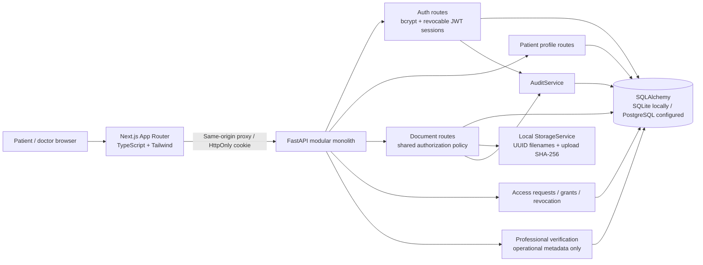
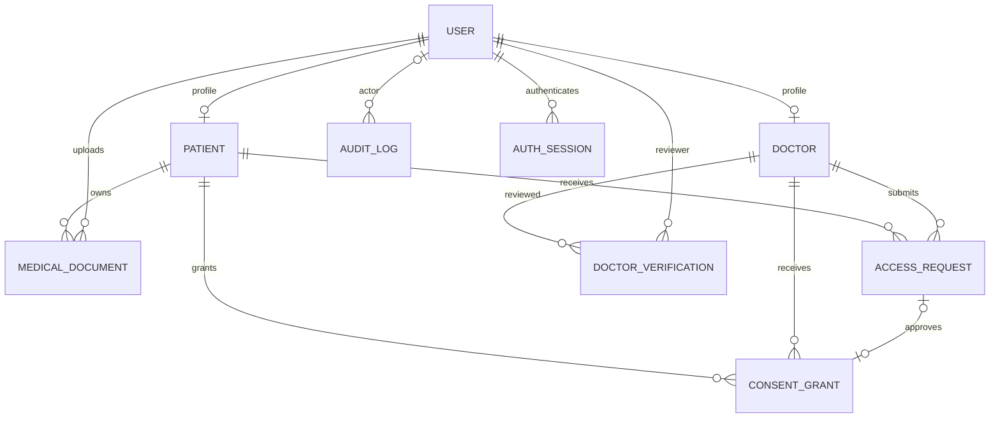
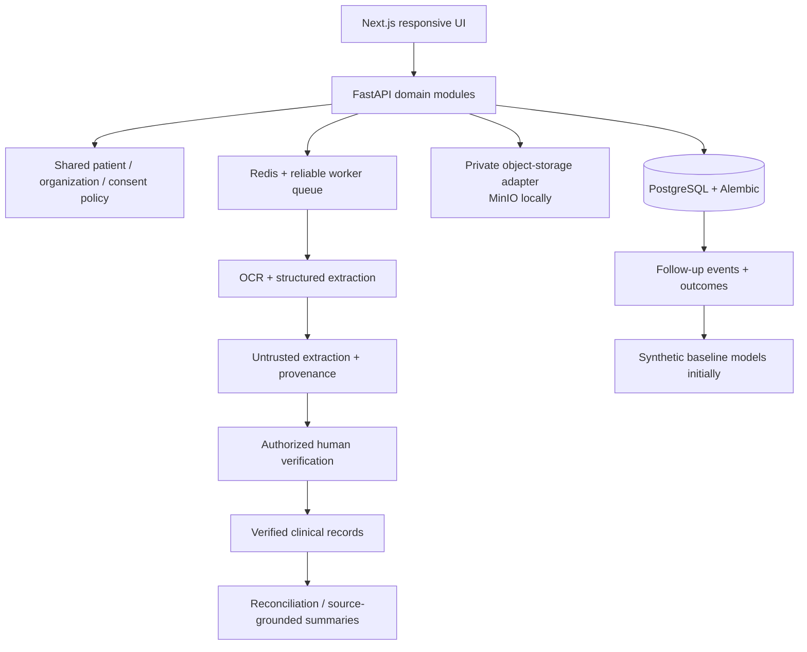

# CareGap 360 architecture

## Product understanding

The intended product is a patient-controlled longitudinal health record platform. It preserves original clinical sources, turns prescriptions into reviewable structured records, lets verified clinicians see only consented information, and tracks unfinished follow-up care. Medication decision support, predictive models and intervention evaluation are later modules with human oversight and explicit evidence requirements.

## Current implementation

PostgreSQL migrations and API regression have been exercised against a dedicated synthetic database. Storage remains local filesystem/Compose volume, not S3/MinIO. Files are parsed at ingestion and checksummed again at download. Redis, Celery and AI services are absent. See PROGRESS.md for the latest checks and deployment limitations.

### Responsibilities

| Location | Responsibility |
| --- | --- |
| `frontend/src/app` | Landing, registration, login and shared dashboard routes. |
| `frontend/src/lib` | Same-origin fetch client, credential cleanup helpers and formatting; tokens are not persisted in browser storage. |
| `frontend/src/components` | Navigation, document cards, stats and upload form. |
| `backend/app/api` | Auth/session, patient profile, document, consent and operational admin handlers. |
| `backend/app/core` | Password/token functions and HTTP error types. |
| `backend/app/models` | SQLAlchemy persistence entities. |
| `backend/app/schemas` | Pydantic API request/response contracts. |
| `backend/app/services` | Shared authorization, session issuance, filesystem storage and audit persistence. |
| `backend/app/database.py` | Engine, declarative base and request sessions. |
| `backend/tests` | Isolated authentication, authorization, consent, storage and migration regression tests. |
| `backend/migrations` | Original six-table baseline, sessions/consent/verification revision, and patient sharing-code migration. |
| `scripts` | Secret configuration, legacy-schema migration and disposable test environments. |

### Actual data model

Internal patient IDs are independent UUIDs. Patients share a unique short code such as `A123`, consisting of one uppercase letter and three digits. Allocation tries random codes then scans free slots, and rejects registration atomically if all 26,000 slots are occupied. Consent requests resolve the code to the original UUID before applying the same authorization rules. Documents retain uploader, owner, original filename, relative path, validated MIME type, length, checksum, status, optional clinical date and timestamps. Clinical version history is not implemented. Consent supports document categories, optional selected IDs, explicit upload permission, expiration and revocation. Access requests and professional verification decisions have persisted histories.

### Current upload/download flow

1. Public registration creates a patient or pending doctor. Administrator provisioning is an explicit CLI operation.
2. Login creates a database session, sets an HttpOnly cookie and returns a bearer token for API clients. Every request checks active user/session state; logout revokes the session.
3. Verified doctors require patient grants; uploads additionally require explicit permission. Administrators have no automatic clinical access.
4. Upload validates ownership/consent, metadata, size and actual file content; hashes the source; and persists metadata plus audit event transactionally. Failure removes the staged file.
5. List/metadata/download share the authorization service, combining effective grants and enforcing selected record IDs. SQL filtering precedes pagination.
6. Download verifies path ancestry and recalculates SHA-256 before returning an authenticated attachment with no-store headers.

## Intended evolution, not implemented functionality

Retain the modular monolith. Introduce domain services for identity/organizations, consent, clinical records, document processing, medication review, care coordination, analytics and interoperability. Routers should call these services rather than each defining its own authorization rules.

Authorization should use the authenticated database identity, organization relationship, verified clinician status, patient grant, requested action and record scope on every access. Patients own their records. Platform administrators manage operational metadata without automatic clinical access. Unknown roles/scopes/actions must fail closed. Revocation blocks future requests, not previously downloaded copies.

Future clinical entities need source links, author identity, timestamps, verification state and revision history. Keep medication orders, dispensing, patient-reported use and clinician-confirmed use distinct. Map them to suitable FHIR concepts only through explicit, tested adapters. An ABHA field is not an ABDM integration.

Extracted values remain untrusted until reviewed. Safety alerts require an appropriate validated knowledge source or clearly synthetic demonstration provider. Risk estimates need temporal evaluation, calibration, subgroup checks and leakage checks; causal effects require suitable outcome data and study design. None of these modules should be represented as currently available.
