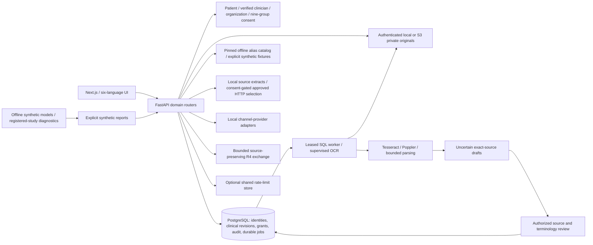
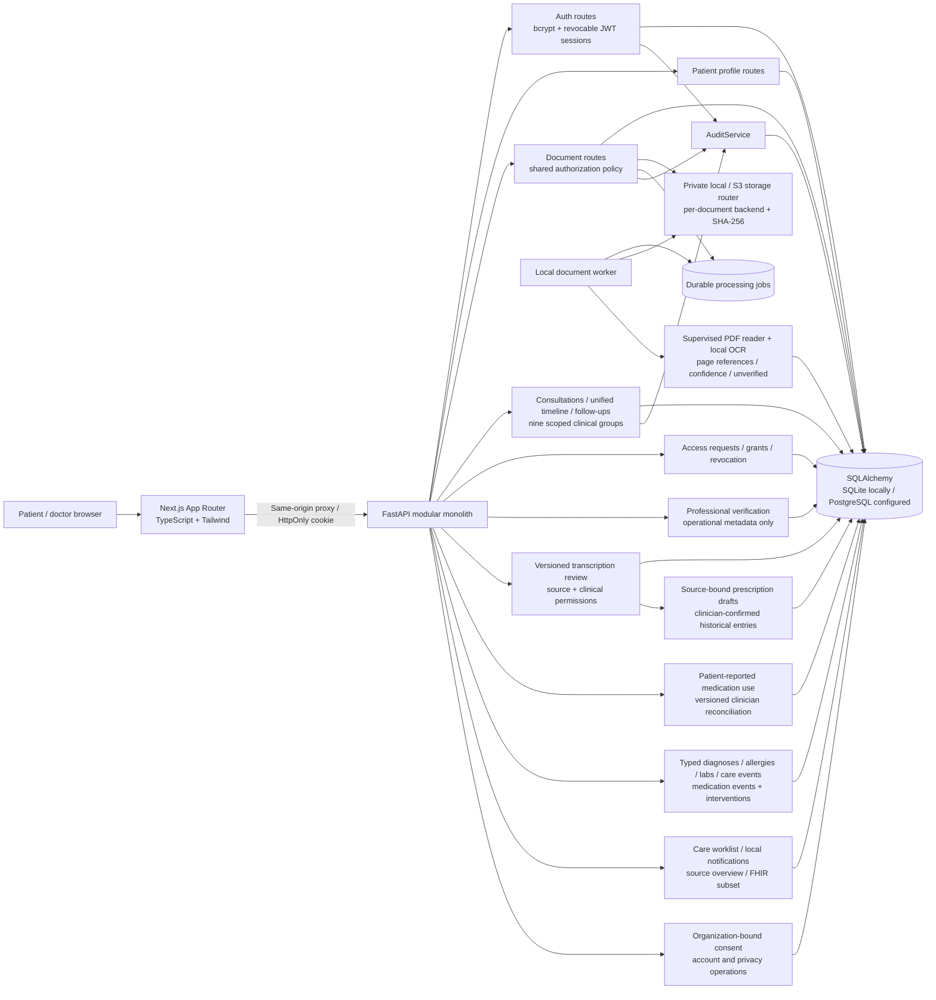
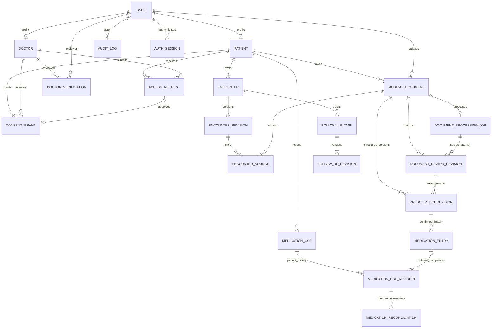
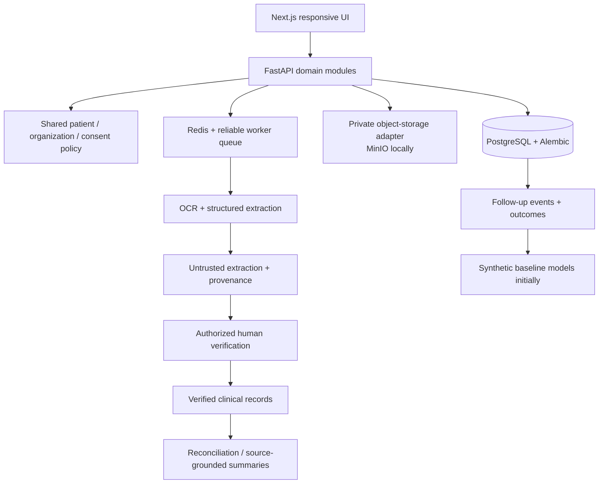

# CareGap 360 architecture

## Current module boundary — 2 November 2026

The implemented system is a modular monolith. This section and MASTER_PROMPT_CHECKLIST.md supersede the historical architecture direction later in this document.

Private source files are immutable; clinical/document/coding corrections retain attributed revisions. Historical prescriptions, reported use, dispensing and clinician-confirmed use remain distinct. Terminology associations are separate checked evidence attached to exact source names, never silent text replacements. Source selection can only return references to already authorized extracts.

The reliable background queue is PostgreSQL-backed, not a second uncoordinated Redis queue. Leases, retries and subprocess limits are tested. Redis is used for shared throttling. Notification providers are local mocks with persisted idempotent receipts; no hidden email/SMS/WhatsApp network path is enabled. Research never reads application patients by default or allocates patient interventions.

The custom typed component/fetch boundary intentionally avoids persistent clinical browser caches. Only locale is stored in localStorage; auth remains HttpOnly and revocable. Permission changes refresh/remount clinical workspaces. This is the documented equivalent to the recommended optional UI/query libraries, not an assertion those packages were installed.

API/ORM schemas and TypeScript enforce boundary types. Hash-pinned Ruff development tooling enforces Python lint/formatting, and CI includes API/migration/browser/type/locale/accessibility/load checks, container builds and source-package verification. Independent clinical/terminology/translation/security/legal review, managed encryption/keys/monitoring and optional external conformance remain deployment gates.

## Product understanding

The intended product is a patient-controlled longitudinal health record platform. It preserves original clinical sources, turns prescriptions into reviewable structured records, lets verified clinicians see only consented information, and tracks unfinished follow-up care. Medication decision support, predictive models and intervention evaluation are later modules with human oversight and explicit evidence requirements.

## Current implementation

PostgreSQL migrations and API regression use a dedicated synthetic database. Private local and real S3-compatible storage are supported, routed per document so old uploads are preserved. MinIO runs as an optional local source-built service. A worker consumes durable SQL jobs, reads PDF text and performs bounded local Tesseract/Poppler OCR. Source transcriptions have attributed, versioned reviews under document and clinical consent. Optional Redis supports shared rate limiting and is exercised in the isolated local TLS rehearsal. Celery and real LLM services are not configured. Nine clinical consent groups filter every aggregate/source/history route; original-document scope remains separately disclosed. See CONSENT_SCOPES.md and PROGRESS.md for precise limits and executed checks.

### Responsibilities

| Location | Responsibility |
| --- | --- |
| `frontend/src/app` | Landing, registration, login and shared dashboard routes. |
| `frontend/src/lib` | Same-origin fetch client, credential cleanup helpers and formatting; tokens are not persisted in browser storage. |
| `frontend/src/components` | Navigation, document cards, stats, upload form, clinical timeline/revision/task forms and role-aware consent workspaces. |
| `backend/app/api` | Auth/session, patient profile, document, clinical records, consent and operational admin handlers. |
| `backend/app/core` | Password/token functions and HTTP error types. |
| `backend/app/models` | SQLAlchemy persistence entities. |
| `backend/app/schemas` | Pydantic API request/response contracts. |
| `backend/app/services` | Shared authorization, session issuance, filesystem storage and audit persistence. |
| `backend/app/database.py` | Engine, declarative base and request sessions. |
| `backend/tests` | Isolated authentication, authorization, consent, storage and migration regression tests. |
| `backend/migrations` | Baseline through `0014`: existing records plus typed health revisions/source links, local notification history, immutable FHIR imports and organization-bound consent/operations. |
| `scripts` | Secret configuration, legacy-schema migration and disposable test environments. |

### Actual data model

Internal patient IDs are independent UUIDs. Patients share a unique short code such as `A123`, consisting of one uppercase letter and three digits. Allocation tries random codes then scans free slots, and rejects registration atomically if all 26,000 slots are occupied. Consent requests resolve the code to the original UUID before applying the same authorization rules. Documents retain uploader, owner, original filename, relative path, validated MIME type, length, checksum, status, optional clinical date and timestamps. Consent supports document categories, optional selected IDs, explicit upload permission, expiration and revocation. Access requests and professional verification decisions have persisted histories.

Encounters and follow-up tasks have stable identities and append-only snapshots with actor, timestamp, provenance and correction reason. Encounter sources link each revision to existing patient-owned documents using foreign keys. Updates compare the expected version atomically, append a revision and audit event in one transaction; stale changes return 409. The timeline combines current encounter revisions and original documents, sorts by clinical date (upload date when missing), and filters before pagination. Dates and overdue calculations use UTC calendar days.

Patients can permanently delete their own consultation, its note history and dependent follow-ups using a version-checked action. Uploaded sources and a metadata-only audit event remain. Note corrections, dependent writes and deletion serialize on the encounter row. The former entered-in-error/restoration controls and filters have been removed; the legacy migration column remains for compatibility.

Uploads transactionally enqueue jobs. Workers use bounded attempts, expiring leases, conditional claims and token-guarded completion; OCR subprocesses have time/memory/text/page limits. Raw result access follows document consent and retries/reprocessing are patient-owner-only. Human-added review text additionally requires clinical consent for doctors, with explicit write permission for edits. Reviews snapshot generated text, checksum, attempt, processor, actor and reason; CAS locks protect concurrent saves/reprocessing. Neither OCR nor transcription reviews create verified medication/diagnosis records. See [DOCUMENT_PROCESSING.md](DOCUMENT_PROCESSING.md).

Clinical read/write consent is explicit and defaults off for migrated grants and requests. It requires an unrestricted all-category document grant; document-only or selected-record grants never imply clinical access. Every clinical read, history view and write checks ownership or verified-doctor consent through the shared policy. Patient corrections of clinician entries become patient-reported without changing previous versions. These labels record provenance, not independent medical verification. See [CLINICAL_RECORDS.md](CLINICAL_RECORDS.md).

Prescription drafts reference immutable reviewed transcription versions and exact Unicode source spans. The conservative parser handles explicit labels; manual edits obey the same source constraints. Missing values remain null and generated fields remain unchecked/uncertain. A document-level compare-and-swap protects draft/source versions. Only a verified, consented clinician can confirm checked source fields into historical `documented_prescription` entries; patients cannot. Latest confirmed revisions determine the displayed entries, while older confirmations remain retained. Newer pending drafts and changed source transcriptions are flagged. These entries are separate from current-use, orders, dispensing and reconciliation resources. See [PRESCRIPTION_DRAFTS.md](PRESCRIPTION_DRAFTS.md).

### Current upload/download flow

Patient medication accounts remain separate from source prescriptions. Only the owner can create/correct them; clinically authorized doctors can append reconciliation assessments, not rewrite patient reports. Assessments bind exact report/source versions and preserve source snapshots. Compare-and-swap updates plus a linked-source lock protect concurrent writes; changed reports/source versions flag old assessments as stale. All reads/history and clinician writes use the existing clinical consent policy. See [MEDICATION_USE.md](MEDICATION_USE.md).

1. Public registration creates a patient or pending doctor. Administrator provisioning is an explicit CLI operation.
2. Login creates a database session, sets an HttpOnly cookie and returns a bearer token for API clients. Every request checks active user/session state; logout revokes the session.
3. Verified doctors require patient grants; uploads additionally require explicit permission. Administrators have no automatic clinical access.
4. Upload validates ownership/consent, metadata, size and actual file content; hashes the source; and persists metadata plus audit event transactionally. Failure removes the staged file.
5. List/metadata/download share the authorization service, combining effective grants and enforcing selected record IDs. SQL filtering precedes pagination.
6. Download verifies path ancestry and recalculates SHA-256 before returning an authenticated attachment with no-store headers.

## Original architecture direction (historical)

Retain the modular monolith. Introduce domain services for identity/organizations, consent, clinical records, document processing, medication review, care coordination, analytics and interoperability. Routers should call these services rather than each defining its own authorization rules.

Authorization should use the authenticated database identity, organization relationship, verified clinician status, patient grant, requested action and record scope on every access. Patients own their records. Platform administrators manage operational metadata without automatic clinical access. Unknown roles/scopes/actions must fail closed. Revocation blocks future requests, not previously downloaded copies.

Future clinical entities need source links, author identity, timestamps, verification state and revision history. Keep medication orders, dispensing, patient-reported use and clinician-confirmed use distinct. Map them to suitable FHIR concepts only through explicit, tested adapters. An ABHA field is not an ABDM integration.

Extracted values remain untrusted until reviewed. Safety alerts require an appropriate validated knowledge source or clearly synthetic demonstration provider. Research estimates need temporal evaluation, calibration, subgroup checks and leakage checks; causal effects require suitable outcome data and study design. The local modules and their bounded/synthetic modes are now implemented as described above; external clinical validity and live integrations must not be represented as verified.
