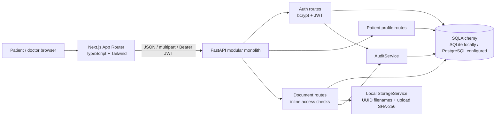
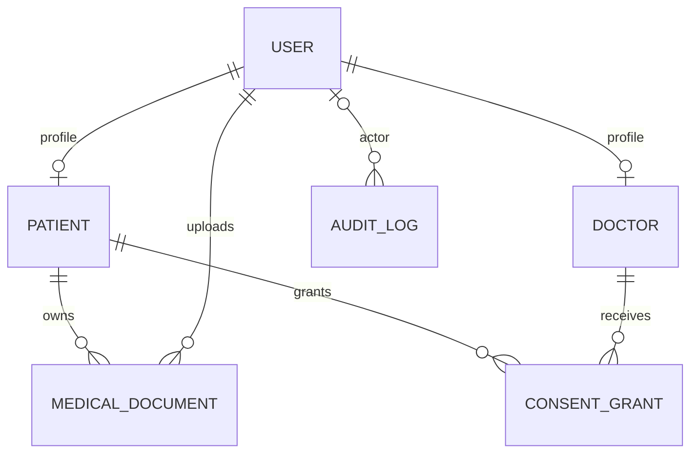
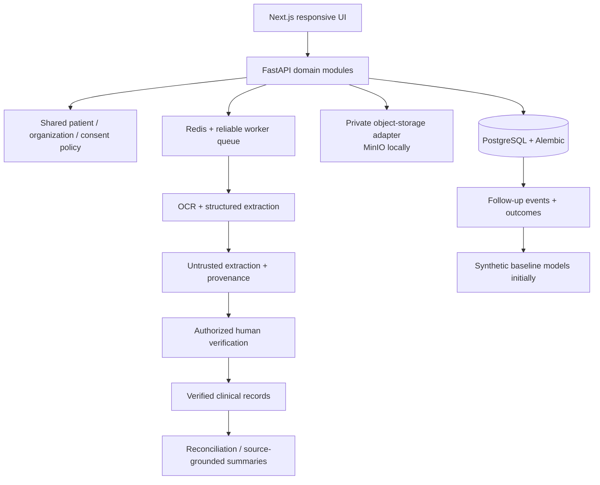

# CareGap 360 architecture

## Product understanding

The intended product is a patient-controlled longitudinal health record platform. It preserves original clinical sources, turns prescriptions into reviewable structured records, lets verified clinicians see only consented information, and tracks unfinished follow-up care. Medication decision support, predictive models and intervention evaluation are later modules with human oversight and explicit evidence requirements.

## Current implementation

PostgreSQL is configured in Compose but not runtime-verified; its Python driver is missing. Storage is local filesystem/Compose volume, not S3/MinIO. Redis, Celery and AI services are absent. See the review for defects in the current access checks.

### Responsibilities

| Location | Responsibility |
| --- | --- |
| `frontend/src/app` | Landing, registration, login and shared dashboard routes. |
| `frontend/src/lib` | Fetch client, localStorage authentication helpers and formatting. |
| `frontend/src/components` | Navigation, document cards, stats and upload form. |
| `backend/app/api` | HTTP handlers, authentication dependencies, profile and document operations. |
| `backend/app/core` | Password/token functions and HTTP error types. |
| `backend/app/models` | SQLAlchemy persistence entities. |
| `backend/app/schemas` | Pydantic API request/response contracts. |
| `backend/app/services` | Filesystem storage and audit persistence. |
| `backend/app/database.py` | Engine, declarative base and request sessions. |
| `backend/tests` | Fifteen backend test functions; current environment cannot execute them. |

### Actual data model

Patient IDs are independent UUIDs. Documents retain uploader, owner, original filename, relative storage path, MIME header, length, upload checksum, status, optional clinical date and timestamps. This preserves basic provenance but does not implement clinical version history or source verification. Audit `patient_id` is indexed metadata without a patient foreign key. Consent is coarse document-type scope with start/end/revocation fields; no access-request entity exists.

### Current upload/download flow

1. Registration creates a user and a patient or pending doctor profile; login returns a signed bearer token.
2. The browser stores the token in localStorage and adds it to API requests.
3. Upload streams the file into a patient directory, calculates SHA-256, inserts document metadata and subsequently inserts an audit event.
4. List/metadata/download query the database. Metadata/download use a shared access helper; listing implements separate authorization logic.
5. Download resolves the stored path and returns a FileResponse. It does not recalculate the stored checksum.

## Intended evolution, not implemented functionality

Retain the modular monolith. Introduce domain services for identity/organizations, consent, clinical records, document processing, medication review, care coordination, analytics and interoperability. Routers should call these services rather than each defining its own authorization rules.

Authorization should use the authenticated database identity, organization relationship, verified clinician status, patient grant, requested action and record scope on every access. Patients own their records. Platform administrators manage operational metadata without automatic clinical access. Unknown roles/scopes/actions must fail closed. Revocation blocks future requests, not previously downloaded copies.

Future clinical entities need source links, author identity, timestamps, verification state and revision history. Keep medication orders, dispensing, patient-reported use and clinician-confirmed use distinct. Map them to suitable FHIR concepts only through explicit, tested adapters. An ABHA field is not an ABDM integration.

Extracted values remain untrusted until reviewed. Safety alerts require an appropriate validated knowledge source or clearly synthetic demonstration provider. Risk estimates need temporal evaluation, calibration, subgroup checks and leakage checks; causal effects require suitable outcome data and study design. None of these modules should be represented as currently available.
